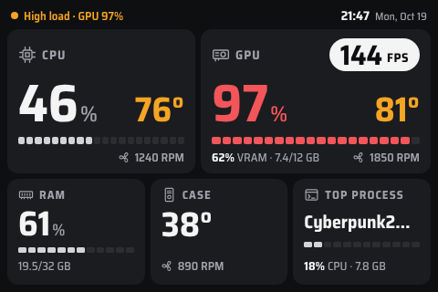

# SleekMon

Moniteur matériel pour le petit écran USB-C **Turing Smart Screen 3.5"** (révision A), sous Windows.
Affiche CPU, GPU, RAM et boîtier avec des couleurs d'état, et éteint l'écran quand le PC est au repos.



## Fonctionnalités

- Tableau de bord 480×320 paysage, dessiné avec **SkiaSharp**.
- Métriques : CPU % et °C, GPU % et °C, VRAM, RAM, température et ventilateur du boîtier, ventilateurs CPU/GPU, heure, processus le plus actif (CPU % et mémoire, regroupé par nom comme dans le Gestionnaire des tâches), FPS de l'appli au premier plan.
- **FPS** : mesurés comme PresentMon (événements graphiques du noyau Windows, rien n'est injecté dans le jeu), pour toutes les API (DirectX, Vulkan, OpenGL) et tous les GPU, en plein écran comme en fenêtré. Affichés toujours pour les jeux reconnus par Windows (liste de la Barre de jeu), même s'ils rament ; pour une autre appli, dès qu'elle affiche au moins 20 images/s pendant 5 s (réglable, voir `fps`). Nécessitent les droits administrateur.
- Couleurs d'état : gris (repos), blanc (normal), orange (élevé), rouge (critique). Ventilateur à l'arrêt (0 RPM) en vert.
- **Veille automatique** : écran éteint quand CPU < 10 %, GPU < 5 % et RAM < 90 % pendant 30 s ; rallumé quand l'un d'eux dépasse son seuil pendant 2 s. Écran éteint aussi pendant la veille du PC et à la fermeture de session.
- Envoi **uniquement des zones modifiées** vers l'écran (~20 Ko par seconde au lieu de 300 Ko) : c'est le transfert USB qui coûte (~170 Ko/s), pas le dessin.
- Icône dans la barre des tâches : état, activer/désactiver, veille automatique, luminosité, relancer en administrateur, quitter.
- Reconnexion automatique (écran débranché, veille du PC).

## Matériel cible

| | |
|---|---|
| Écran | Turing Smart Screen 3.5" IPS, révision A — USB `VID_1A86&PID_5722`, n° de série `USB35INCHIPSV2`, 320×480 natif (utilisé en 480×320 paysage). |
| Système | Windows 11 x64 |

## Prérequis

- **.NET 10** (SDK pour compiler, Desktop Runtime pour exécuter), x64.
- **PawnIO** installé : pilote noyau utilisé par LibreHardwareMonitor ≥ 0.9.6 pour la température CPU AMD et les capteurs de la carte mère. Sans lui, ces valeurs s'affichent `--`.
  LibreHardwareMonitor ne l'installe pas tout seul (l'appli LibreHardwareMonitor propose de l'installer, version ≥ 2.0).
- **Droits administrateur** (recommandés, pas obligatoires) pour la température du CPU, les capteurs de la carte mère et les FPS. **L'appli fonctionne aussi sans** : l'écran s'affiche normalement avec CPU %, GPU (charge, température, VRAM, ventilateur), RAM, heure et processus le plus actif ; seuls la température du CPU et les capteurs de la carte mère (ventilateurs CPU et boîtier, température du boîtier) affichent `--` et les FPS ne s'affichent pas, avec la mention « Limited sensors · run as admin » dans la ligne de statut. La tâche planifiée ci-dessous lui donne les droits ; sinon, « Restart as administrator » dans le menu de l'icône.
- Fermer toute autre appli qui utilise l'écran (Rizplay, USBMonitor.exe, turing-smart-screen-python…) : le port COM est exclusif.

## Installation

Dans un **PowerShell administrateur**. Quitter d'abord SleekMon depuis son icône s'il tourne.

**1. Récupérer l'appli**, de l'une des deux façons :

- **Depuis une release** (le .NET 10 Desktop Runtime suffit) : télécharger `SleekMon-vX.Y.Z-win-x64.zip` depuis la [page des releases](https://github.com/Nico04/SleekMon/releases), puis, depuis le dossier du zip :

  ```powershell
  # Facultatif : comparer avec le contenu de SHA256SUMS.txt (publié avec le zip)
  Get-FileHash .\SleekMon-vX.Y.Z-win-x64.zip

  # Retirer le marquage « téléchargé depuis Internet », puis extraire
  Unblock-File .\SleekMon-vX.Y.Z-win-x64.zip
  Expand-Archive .\SleekMon-vX.Y.Z-win-x64.zip "$env:LOCALAPPDATA\Programs\SleekMon" -Force
  ```

- **Depuis les sources** (le SDK .NET 10 est nécessaire), à la racine du dépôt :

  ```powershell
  dotnet publish src/SleekMon -c Release -o "$env:LOCALAPPDATA\Programs\SleekMon"
  ```

**2. Démarrage automatique** (à l'ouverture de session, avec les droits administrateur, sans limite de durée) :

```powershell
$exe = "$env:LOCALAPPDATA\Programs\SleekMon\SleekMon.exe"
Register-ScheduledTask -TaskName SleekMon -Force `
    -Action (New-ScheduledTaskAction -Execute $exe) `
    -Trigger (New-ScheduledTaskTrigger -AtLogOn -User $env:USERNAME) `
    -Principal (New-ScheduledTaskPrincipal -UserId $env:USERNAME -LogonType Interactive -RunLevel Highest) `
    -Settings (New-ScheduledTaskSettingsSet -ExecutionTimeLimit ([TimeSpan]::Zero) -AllowStartIfOnBatteries -DontStopIfGoingOnBatteries)

# Lancer tout de suite
Start-ScheduledTask -TaskName SleekMon
```

Mettre à jour : quitter SleekMon, refaire l'étape 1 (le nouveau zip ou `dotnet publish` écrase les fichiers, mais ne supprime pas les anciens), puis `Start-ScheduledTask -TaskName SleekMon`.

### Avertissements de Windows et des antivirus

L'exécutable **n'est pas signé** (un certificat de signature de code coûte de l'argent chaque année, ce qui n'est pas justifié pour un petit projet gratuit). Conséquences possibles :

- **SmartScreen** (« Windows a protégé votre ordinateur ») au premier lancement d'un exe téléchargé : cliquer sur « Informations complémentaires », puis « Exécuter quand même ». `Unblock-File` ci-dessus évite normalement ce message.
- **Un antivirus** peut signaler l'exe, d'autant que l'appli lit les capteurs de la carte mère via un pilote noyau (PawnIO, dont se sert LibreHardwareMonitor). Les alertes de ce genre sont fréquentes pour les outils de ce type, mais le comportement de chaque antivirus n'a pas été vérifié.

Si cela vous gêne, vérifiez l'empreinte du zip avec `SHA256SUMS.txt`, ou compilez vous-même depuis les sources : le code est entièrement dans ce dépôt, et les releases sont produites par [`.github/workflows/release.yml`](.github/workflows/release.yml).

### Désinstaller

```powershell
Unregister-ScheduledTask -TaskName SleekMon -Confirm:$false
Remove-Item -Recurse "$env:LOCALAPPDATA\Programs\SleekMon", "$env:APPDATA\SleekMon"
```

## Configuration

`%AppData%\SleekMon\config.json`, créé au premier lancement avec les valeurs par défaut. Exemple complet : [`config.example.json`](config.example.json).
Le menu de l'icône enregistre lui-même `enabled`, `powerSaving` et `brightness` ; le reste se modifie à la main, puis relancer l'appli.

| Clé | Rôle |
|---|---|
| `enabled` | Désactivé : écran éteint, port libéré, capteurs arrêtés. |
| `powerSaving` | Veille automatique (règle dans `idle`). |
| `brightness`, `brightnessLevels` | Luminosité (%) et paliers proposés dans le menu. |
| `topProcessMinCpu` | En dessous de ce % CPU, la carte du processus le plus actif affiche `--`. |
| `fps` | Pastille FPS de l'appli au premier plan. Toujours affichée pour les jeux reconnus par Windows et les exe de `always` (`["GravityMark.exe"]`), jamais pour ceux de `never` (`["firefox.exe"]`). Pour une autre appli : affichée après `minSeconds` s d'affilée à au moins `minFps` images/s, masquée après autant de secondes en dessous. |
| `idle` | Seuils de la veille : `cpuBelow`, `gpuBelow` (%), `ramAbove` (% qui garde l'écran allumé), `delaySeconds`, `wakeAfterSeconds`. |
| `sensors` | Capteurs de la carte mère, par leur nom : `cpuFan`, `caseFan`, `caseTemperature`. Les noms (`Fan #2`, `Temperature #2`…) dépendent de chaque carte : les trouver avec `--dump-sensors` et un outil comme HWMonitor. `null` : affiché `--`. |
| `port` | Port COM forcé ; `null` : détecté automatiquement. |

Journal : `%LocalAppData%\SleekMon\logs\`.

## Commandes de diagnostic

L'appli est graphique : ses commandes écrivent dans le journal, pas dans la console. En PowerShell, ajouter `| Out-Null` pour attendre la fin.

```powershell
SleekMon.exe                                  # appli normale (icône dans la barre des tâches)
SleekMon.exe --find-port                      # port détecté
SleekMon.exe --test-pattern                   # mire de test (orientation, alignement, couleurs)
SleekMon.exe --show image.png                 # affiche un PNG 480×320
SleekMon.exe --render all dossier             # rend les scénarios simulés en PNG, sans écran
SleekMon.exe --run-fake                       # boucle réelle sur valeurs simulées
SleekMon.exe --run                            # boucle réelle avec les vrais capteurs, sans l'icône
SleekMon.exe --dump-sensors sensors.txt       # tous les capteurs (lancer en administrateur)
SleekMon.exe --bench-sensors                  # coût de lecture de chaque matériel
```

## Crédits et licences

SleekMon est distribué sous licence BSD 3-Clause (voir [LICENSE](LICENSE)).

- Protocole de l'écran : documenté par [turing-smart-screen-python](https://github.com/mathoudebine/turing-smart-screen-python) (GPL-3.0). **Aucun code n'en est recopié** : le pilote est réécrit à partir des faits du protocole.
- [usausa/turing-smart-screen](https://github.com/usausa/turing-smart-screen) (MIT) : référence C# pour l'encodage des commandes.
- [LibreHardwareMonitor](https://github.com/LibreHardwareMonitor/LibreHardwareMonitor) (MPL-2.0) : capteurs, via le paquet NuGet `LibreHardwareMonitorLib`.
- Police [Saira Semi Condensed](https://fonts.google.com/specimen/Saira+Semi+Condensed) (SIL OFL 1.1).
